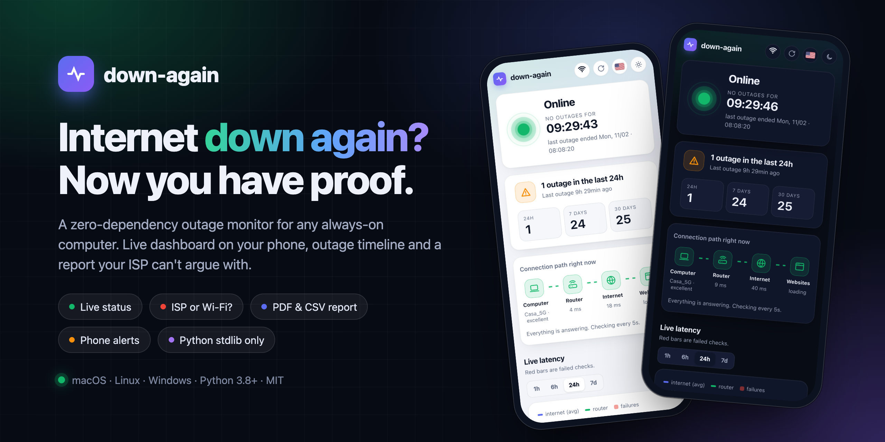
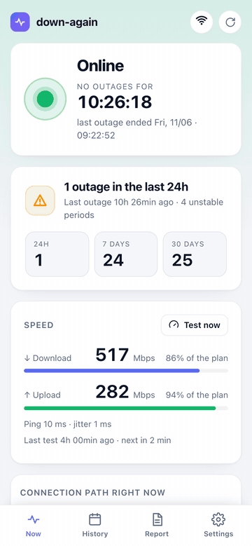
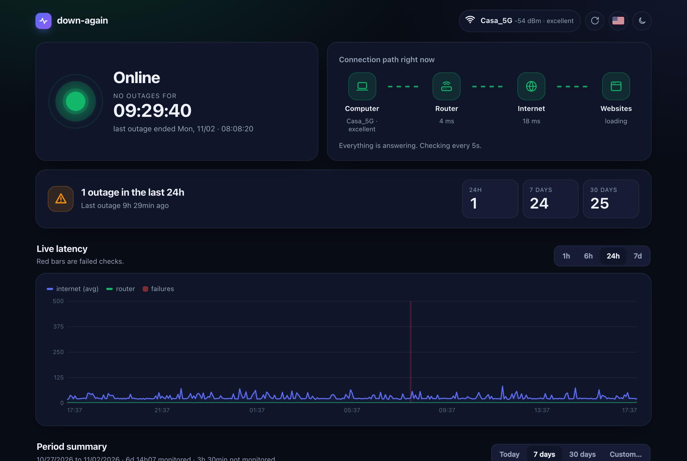
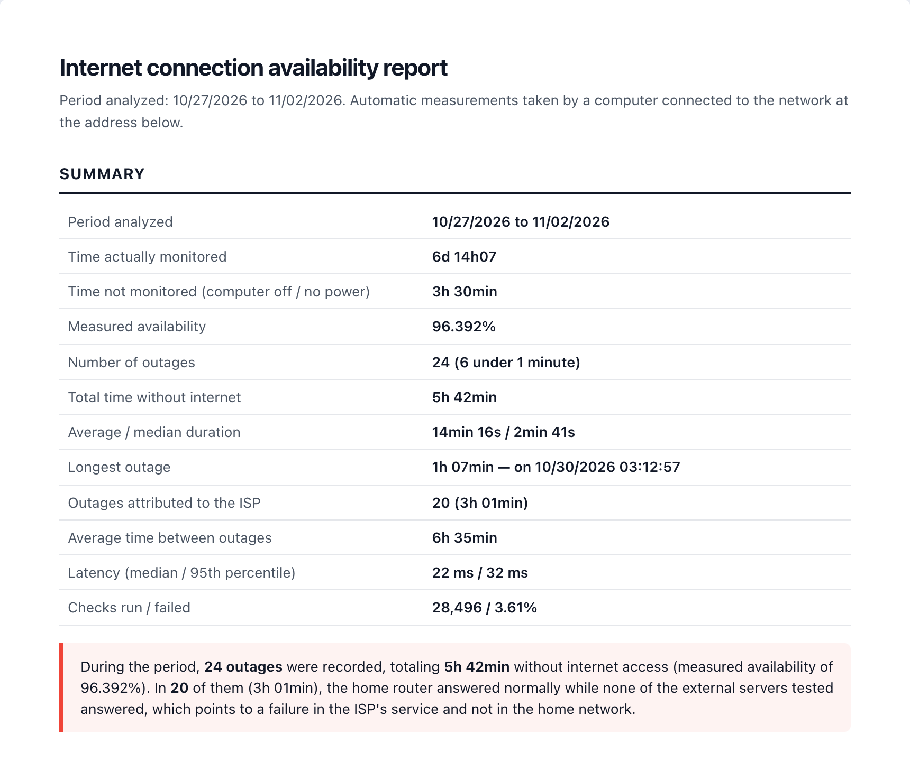

<p align="center">
  
</p>

<p align="center">
  
  
  
  
  
</p>

<p align="center">
  🇺🇸 <b>English</b> · 🇧🇷 <a href="README_pt-BR.md">Português</a> · 🇨🇳 <a href="README_zh-CN.md">中文</a>
</p>

**down-again** watches your home internet from any always-on computer, shows a live dashboard on your phone, and builds a report you can send to your ISP when the connection keeps dropping.

## Features

- 🟢 **Live status**: online or offline, with a timer and the likely cause.
- 🔍 **Who's to blame**: the ISP, your Wi-Fi or DNS.
- 📊 **History**: daily timeline and outage counts for 24 h, 7 days and 30 days.
- 🧾 **ISP report**: print or save as PDF, plus CSV for spreadsheets.
- 📱 **Phone alerts**: a message as soon as the internet is back.
- 🌐 **3 languages**: English, Português and 中文.
- 🪶 **Zero dependencies**: just Python. The dashboard works even with the internet down.

## Screenshots

<table>
  <tr>
    <td width="34%" valign="top"></td>
    <td valign="top">
      <br><br>
      
    </td>
  </tr>
</table>

<sub>Screenshots use simulated data.</sub>

## Quick start

```bash
git clone https://github.com/Bruno-Furtado/down-again.git
cd down-again
python3 down_again.py check     # one-off diagnosis
python3 down_again.py           # start the monitor and the dashboard
```

Open `http://localhost:8000`, or `http://<computer-name>.local:8000` on your phone.
To keep it running in the background and start it with the computer:

```bash
python3 down_again.py install   # undo with: python3 down_again.py uninstall
```

On Windows, use `py` instead of `python3`.

## Platforms

| | Status | Runs in the background with |
|---|---|---|
| **macOS 11+** | ✅ Tested | LaunchAgent |
| **Linux** (Raspberry Pi, Ubuntu…) | ⚠️ Experimental, not yet tested on a real machine | systemd |
| **Windows 10/11** | ⚠️ Experimental, not yet tested on a real machine | Task Scheduler |

Tried it on Linux or Windows? Please [open an issue](https://github.com/Bruno-Furtado/down-again/issues/new/choose) with the output of `check`, whether it worked or not.

## Phone alerts

1. Install the **ntfy** app (iOS / Android).
2. Subscribe to the topic shown on the dashboard.
3. Tap **Send test**.

## More details

<details>
<summary><b>How it works</b></summary>

Every 5 seconds it checks three things: the **router** (ping), the **internet by IP** (`1.1.1.1`, `8.8.8.8`, `208.67.222.222`) and a **website by name** (DNS).
An outage is recorded after 2 failed checks in a row.

| What was observed | Cause |
|---|---|
| Router answers, internet doesn't | ISP |
| Router doesn't answer | Local network / Wi-Fi |
| Internet answers by IP, websites don't | DNS |
| Router never answers ping | Unknown |

Time when the computer is off or asleep is marked as *not monitored*. It is never counted as an outage.
</details>

<details>
<summary><b>Configuration</b> (<code>dados/config.json</code>)</summary>

| Key | Default | What it does |
|---|---|---|
| `language` | `auto` | `en`, `pt` or `zh` for alerts, CSV and terminal. `auto` follows the system |
| `port` | `8000` | Dashboard port |
| `bind` | `0.0.0.0` | Use `127.0.0.1` to keep the dashboard on this computer only |
| `allowed_hosts` | `[]` | Extra hostnames for the dashboard (IPs, `localhost`, `*.local` and the computer's name always work) |
| `interval` | `5` | Seconds between checks |
| `fail_threshold` | `2` | Failed checks in a row that count as an outage |
| `ntfy_topic` | random | ntfy topic. Use `""` to turn alerts off |
| `ntfy_server` | `https://ntfy.sh` | Your own ntfy server, if you have one |
| `notify_min_seconds` | `0` | Only alert about outages at least this long |
| `keep_samples_days` | `120` | Days of raw checks to keep (outages are kept forever) |

Restart down-again after editing.
</details>

<details>
<summary><b>Running it as a server</b></summary>

- **Use an Ethernet cable** to the router, so an outage points at the ISP and not at weak Wi-Fi.
- **macOS:** turn on *Prevent automatic sleeping* and *Start up automatically after a power failure*, plus automatic login. Don't keep the folder in Desktop, Documents or Downloads.
- **Linux:** run `sudo loginctl enable-linger $USER` so it starts at boot. The `.local` name needs `avahi-daemon`.
- **Windows:** set Sleep to *Never* and the network profile to *Private*.
</details>

<details>
<summary><b>Security</b></summary>

Made for a **trusted home network**. There is no login, so **don't expose the port to the internet**.
It blocks DNS rebinding, CSRF and path traversal, and sends a strict Content-Security-Policy.
The ntfy topic works like a password.
See [SECURITY.md](SECURITY.md) to report a vulnerability.
</details>

<details>
<summary><b>API</b></summary>

`GET /api/status`, `/api/glance`, `/api/summary?from=&to=`, `/api/timeseries?hours=`, `/api/outages.csv?from=&to=&lang=` and `/api/config`.
`POST /api/test-notify` requires the `X-Down-Again: 1` header.
</details>

## Contributing

Pull requests are welcome, especially from people who can test on Linux and Windows.
See [CONTRIBUTING.md](CONTRIBUTING.md). AI coding agents should read [AGENTS.md](AGENTS.md).

## License

[MIT](LICENSE)

---

<div align="center">
  <sub>Made with ♥ in Curitiba 🌲 ☔️</sub>
</div>
