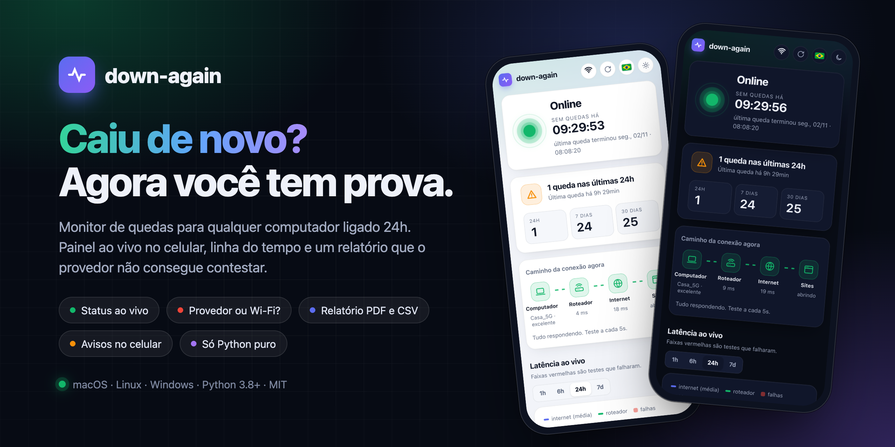
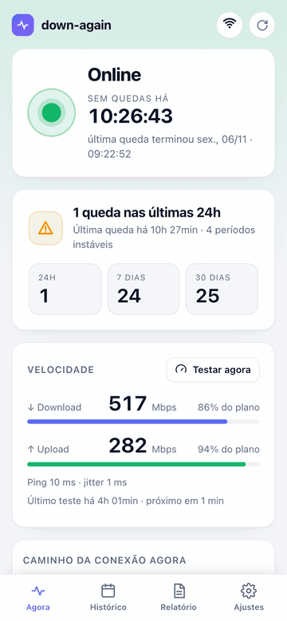
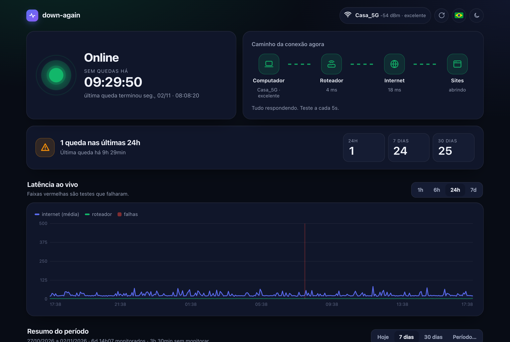
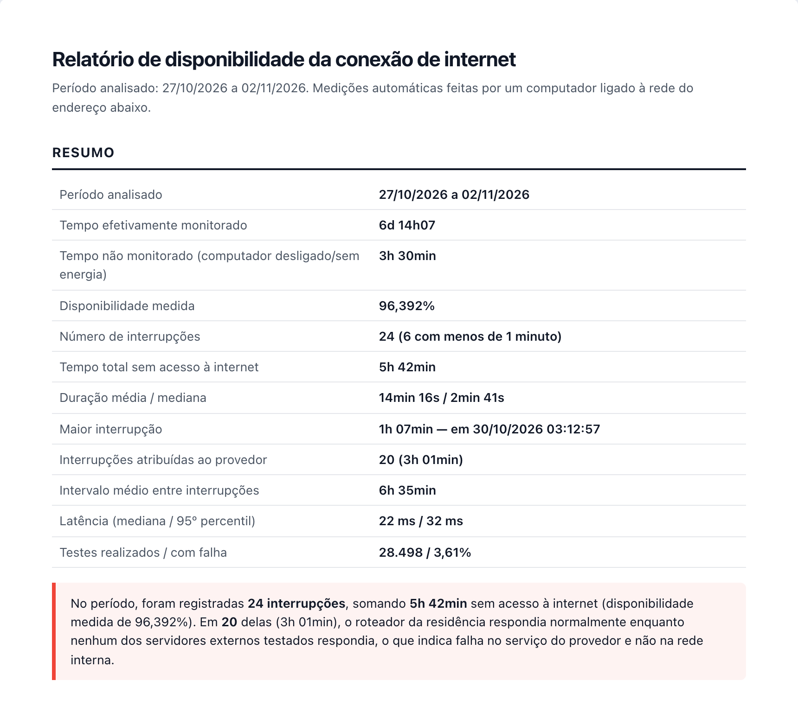

<p align="center">
  
</p>

<p align="center">
  
  
  
  
  
</p>

<p align="center">
  🇺🇸 <a href="README.md">English</a> · 🇧🇷 <b>Português</b> · 🇨🇳 <a href="README_zh-CN.md">中文</a>
</p>

O **down-again** vigia a internet de casa a partir de qualquer computador ligado 24h, mostra um painel ao vivo no celular e gera um relatório para mandar ao provedor quando a conexão não para de cair.

## Recursos

- 🟢 **Status ao vivo**: online ou fora do ar, com cronômetro e causa provável.
- 🔍 **De quem é a culpa**: provedor, seu Wi-Fi ou DNS.
- 📊 **Histórico**: linha do tempo por dia e quedas em 24h, 7 e 30 dias.
- 🧾 **Relatório para o provedor**: imprimir ou salvar em PDF, mais CSV para planilhas.
- 📱 **Avisos no celular**: uma mensagem assim que a internet volta.
- 🌐 **3 idiomas**: English, Português e 中文.
- 🪶 **Zero dependências**: só Python. O painel funciona mesmo com a internet fora.

## Telas

<table>
  <tr>
    <td width="34%" valign="top"></td>
    <td valign="top">
      <br><br>
      
    </td>
  </tr>
</table>

<sub>As telas usam dados simulados.</sub>

## Começando

```bash
git clone https://github.com/Bruno-Furtado/down-again.git
cd down-again
python3 down_again.py check     # diagnóstico único
python3 down_again.py           # inicia o monitor e o painel
```

Abra `http://localhost:8000`, ou `http://<nome-do-computador>.local:8000` no celular.
Para deixar rodando em segundo plano e iniciar junto com o computador:

```bash
python3 down_again.py install   # para desfazer: python3 down_again.py uninstall
```

No Windows, use `py` no lugar de `python3`.

## Sistemas

| | Situação | Roda em segundo plano com |
|---|---|---|
| **macOS 11+** | ✅ Testado | LaunchAgent |
| **Linux** (Raspberry Pi, Ubuntu…) | ⚠️ Experimental, ainda não testado em máquina real | systemd |
| **Windows 10/11** | ⚠️ Experimental, ainda não testado em máquina real | Agendador de Tarefas |

Testou no Linux ou no Windows? [Abra uma issue](https://github.com/Bruno-Furtado/down-again/issues/new/choose) com a saída do `check`, tenha funcionado ou não.

## Avisos no celular

1. Instale o app **ntfy** (iOS / Android).
2. Assine o tópico que aparece no painel.
3. Toque em **Enviar teste**.

## Mais detalhes

<details>
<summary><b>Como funciona</b></summary>

A cada 5 segundos ele testa três coisas: o **roteador** (ping), a **internet por IP** (`1.1.1.1`, `8.8.8.8`, `208.67.222.222`) e um **site por nome** (DNS).
Uma queda é registrada depois de 2 testes seguidos com falha.

| O que foi observado | Causa |
|---|---|
| Roteador responde, internet não | Provedor |
| Roteador não responde | Rede local / Wi-Fi |
| Internet responde por IP, sites não | DNS |
| Roteador nunca responde a ping | Indeterminada |

O tempo em que o computador fica desligado ou dormindo é marcado como *não monitorado*. Ele nunca conta como queda.
</details>

<details>
<summary><b>Configuração</b> (<code>dados/config.json</code>)</summary>

| Chave | Padrão | O que faz |
|---|---|---|
| `language` | `auto` | `en`, `pt` ou `zh` para avisos, CSV e terminal. `auto` segue o sistema |
| `port` | `8000` | Porta do painel |
| `bind` | `0.0.0.0` | Use `127.0.0.1` para deixar o painel só neste computador |
| `allowed_hosts` | `[]` | Nomes extras para o painel (IPs, `localhost`, `*.local` e o nome do computador sempre valem) |
| `interval` | `5` | Segundos entre testes |
| `fail_threshold` | `2` | Falhas seguidas que contam como queda |
| `ntfy_topic` | aleatório | Tópico do ntfy. Use `""` para desligar os avisos |
| `ntfy_server` | `https://ntfy.sh` | Seu próprio servidor ntfy, se tiver |
| `notify_min_seconds` | `0` | Só avisa quedas com pelo menos esse tempo |
| `keep_samples_days` | `120` | Dias de testes brutos guardados (as quedas ficam para sempre) |

Reinicie o down-again depois de editar.
</details>

<details>
<summary><b>Usando como servidor</b></summary>

- **Use cabo de rede** no roteador. Assim uma queda aponta para o provedor e não para um Wi-Fi fraco.
- **macOS:** ative *Evitar repouso automático* e *Iniciar automaticamente após falta de energia*, além do início de sessão automático. Não deixe a pasta em Mesa, Documentos ou Downloads.
- **Linux:** rode `sudo loginctl enable-linger $USER` para subir no boot. O nome `.local` precisa do `avahi-daemon`.
- **Windows:** deixe a suspensão em *Nunca* e o perfil da rede como *Privada*.
</details>

<details>
<summary><b>Segurança</b></summary>

Feito para uma **rede doméstica confiável**. Não há login, então **não exponha a porta para a internet**.
Ele bloqueia DNS rebinding, CSRF e path traversal, e envia uma Content-Security-Policy rígida.
O tópico do ntfy funciona como senha.
Para relatar uma vulnerabilidade, veja o [SECURITY.md](SECURITY.md).
</details>

<details>
<summary><b>API</b></summary>

`GET /api/status`, `/api/glance`, `/api/summary?from=&to=`, `/api/timeseries?hours=`, `/api/outages.csv?from=&to=&lang=` e `/api/config`.
`POST /api/test-notify` exige o cabeçalho `X-Down-Again: 1`.
</details>

## Contribuindo

Pull requests são bem-vindos, principalmente de quem puder testar em Linux e Windows.
Veja o [CONTRIBUTING.md](CONTRIBUTING.md). Agentes de IA devem ler o [AGENTS.md](AGENTS.md).

## Licença

[MIT](LICENSE)

---

<div align="center">
  <sub>Feito com ♥ em Curitiba 🌲 ☔️</sub>
</div>
