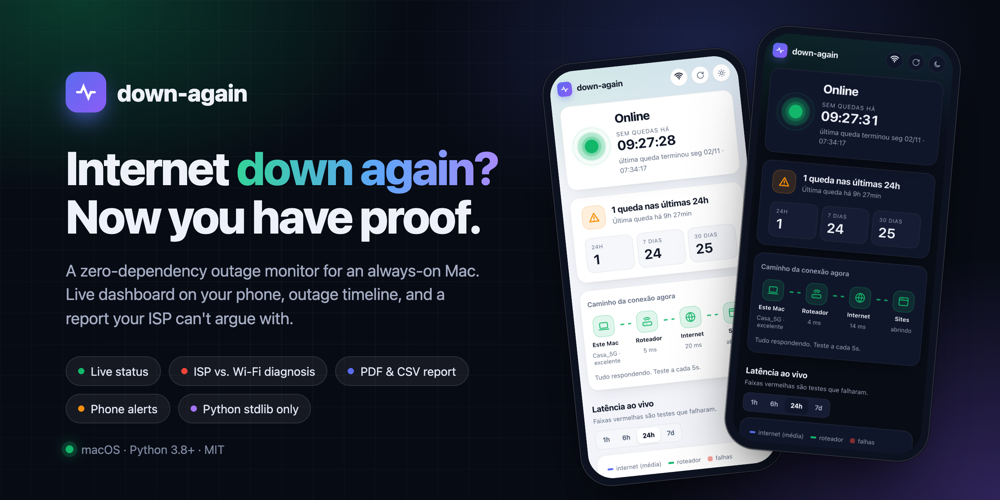
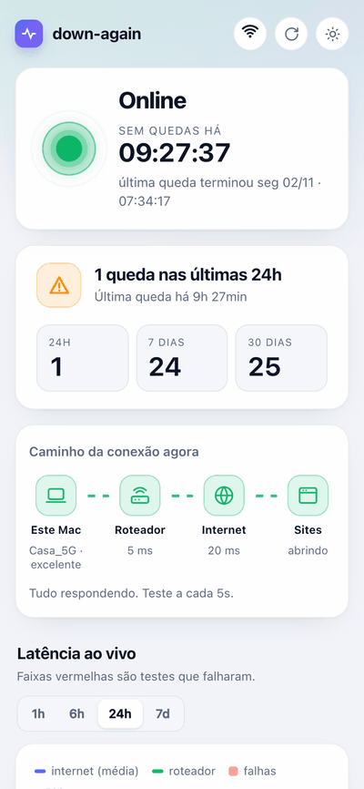
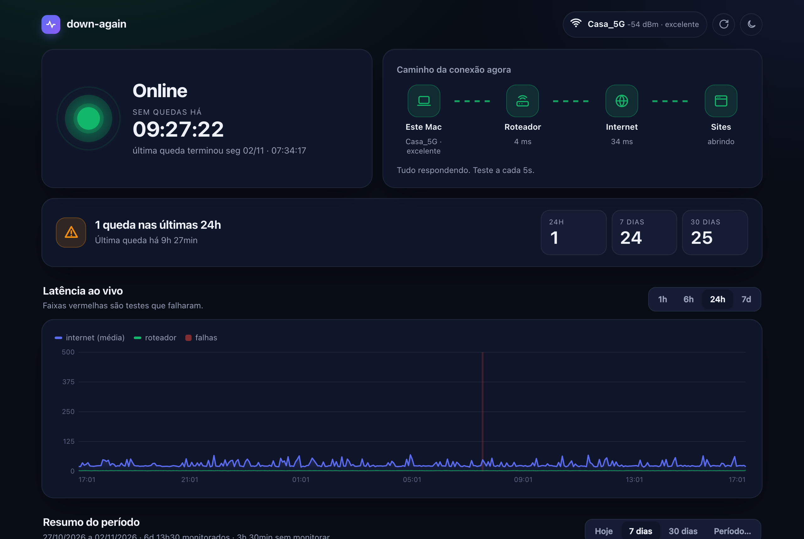
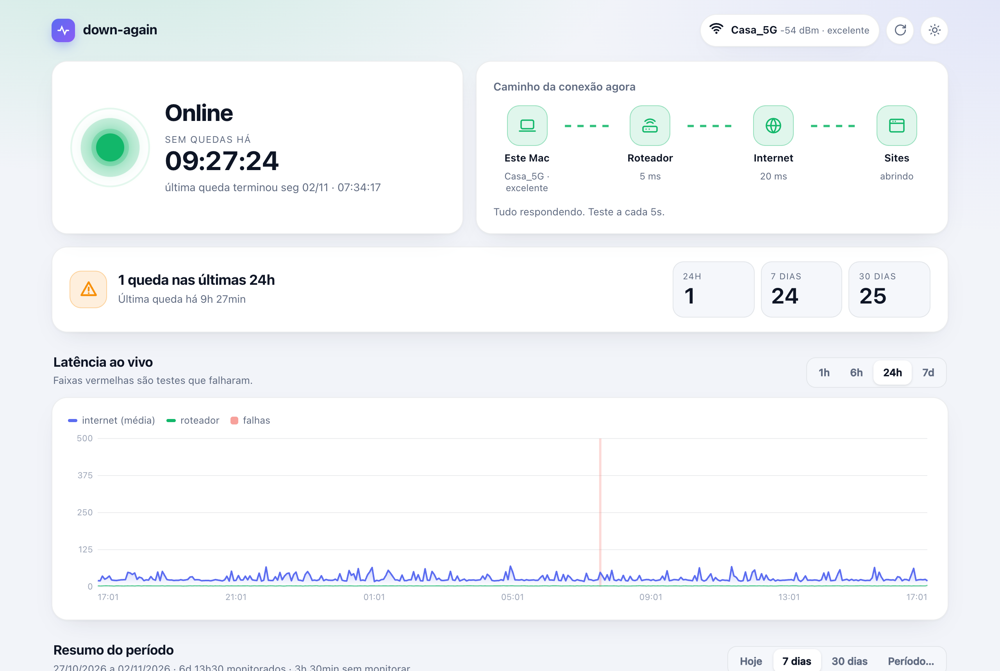
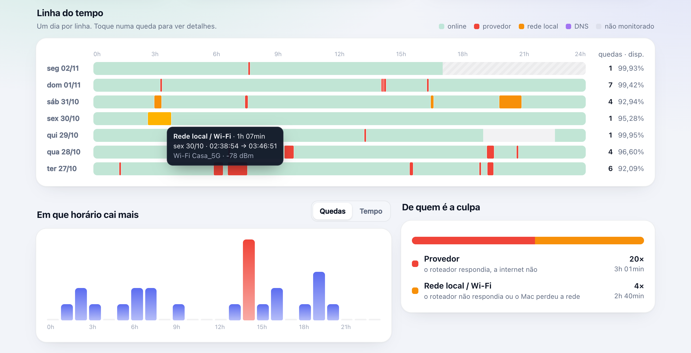
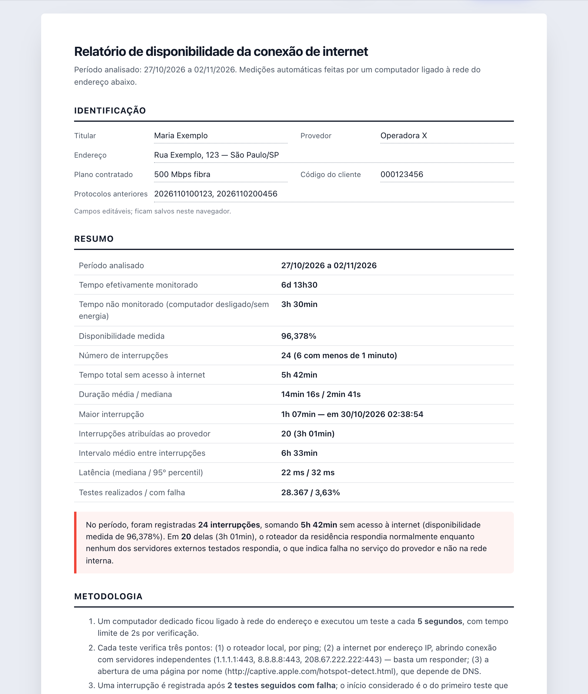

# down-again



Monitor de quedas de internet para um computador que fica ligado o tempo todo. Ele testa a conexão
a cada poucos segundos, mostra um painel ao vivo que você abre no celular e gera um relatório pronto
para imprimir e mandar para o provedor quando a internet não para de cair.


[English](README.md) · **Português** · [中文](README_zh-CN.md)

## Recursos

- **Status ao vivo**: "Online" ou "Sem internet", com cronômetro e causa provável.
- **Caminho da conexão**: computador → roteador → internet → sites, mostrando exatamente onde parou.
- **Últimas 24h num relance**: quantidade de quedas em 24h, 7 dias e 30 dias, no topo da página.
- **Dados do Wi-Fi**: nome da rede, força do sinal, canal e velocidade do link (ou "cabo" no Ethernet).
- **Gráfico de latência ao vivo** (1h / 6h / 24h / 7d), com os testes que falharam destacados.
- **Linha do tempo por dia**: uma faixa de 24h por dia, com cada queda colorida pela causa.
- **Análises**: horário em que mais cai, de quem é a culpa (provedor, rede local ou DNS) e lista de quedas com filtro.
- **Relatório para o provedor**: documento pronto para imprimir ou salvar em PDF, com metodologia, resumo, tabela por dia e todas as quedas, mais exportação em CSV.
- **Avisos no celular** pelo [ntfy](https://ntfy.sh). Quando a internet volta, chega "caiu às X, voltou às Y".
- **Funciona sem internet**: sem CDN e sem fontes externas. O painel abre pela rede de casa mesmo com a internet fora.
- **Zero dependências**: só a biblioteca padrão do Python e o SQLite.

## Telas

<p align="center">
  
</p>

| Tema escuro | Tema claro |
|---|---|
|  |  |

**Linha do tempo e análises**: passe o mouse numa queda para ver causa, duração e sinal do Wi-Fi.



**Relatório para o provedor**: imprima ou salve em PDF.



> As telas usam dados simulados.

## Sistemas suportados

| Sistema | Situação | Roda em segundo plano com |
|---|---|---|
| **macOS 11+** | ✅ Testado em máquina real | LaunchAgent + `caffeinate` |
| **Linux** (Raspberry Pi OS, Ubuntu, Debian…) | ⚠️ Experimental: **ainda não testado em máquina real** | serviço de usuário do systemd |
| **Windows 10/11** | ⚠️ Experimental: **ainda não testado em máquina real** | Agendador de Tarefas |

Os testes de conexão, o banco, o painel e o relatório são iguais em todos os sistemas. Só uma camada pequena muda: achar o roteador, as opções do ping, ler os dados do Wi-Fi e iniciar em segundo plano. Essa camada tem testes com saídas de exemplo de cada sistema, mas Linux e Windows **ainda não rodaram numa máquina real**.
Se você testar num deles, [abra uma issue](https://github.com/Bruno-Furtado/down-again/issues) com a saída do `check`, tenha funcionado ou não.

Um **Raspberry Pi** no cabo é um ótimo monitor dedicado: barato, silencioso e gasta quase nada de energia.

## Como funciona

A cada 5 segundos o down-again faz três testes:

1. **Roteador**: ping no gateway padrão.
2. **Internet por IP**: conexão TCP com `1.1.1.1`, `8.8.8.8` ou `208.67.222.222` na porta 443. Basta um responder.
3. **Site por nome**: acessa `http://captive.apple.com/hotspot-detect.html`, que depende do DNS.

Uma queda é registrada depois de **2 testes seguidos com falha**. Ela começa no primeiro teste que falhou e termina no primeiro que funcionou. A causa provável é definida assim:

| O que foi observado | Causa |
|---|---|
| Roteador responde, internet não | **Provedor** |
| Roteador não responde, ou o computador perdeu a rede | **Rede local / Wi-Fi** |
| Internet responde por IP, mas os nomes não resolvem | **DNS** |
| Roteador nunca responde a ping, então não dá para separar local de provedor | **Indeterminada** |

Quando o computador dorme, desliga ou fica sem energia, esse tempo é marcado como **não monitorado** e sai do cálculo de disponibilidade. Ele nunca conta como queda.

## Requisitos

- Um computador que fique ligado, com um dos sistemas acima.
- Python 3.8 ou mais novo:
  - **macOS**: o `python3` vem com as Command Line Tools (`xcode-select --install`).
  - **Linux**: já vem na maioria das distribuições.
  - **Windows**: instale pelo [python.org](https://www.python.org/downloads/) e marque **Add Python to PATH**.
- Opcional, no Linux: `iw` ou `nmcli`, para os dados do Wi-Fi.
- De preferência, **cabo de rede** no roteador. Assim uma queda registrada aponta para o provedor e não para um Wi-Fi fraco.

## Começando

**macOS / Linux**

```bash
git clone https://github.com/Bruno-Furtado/down-again.git ~/down-again
cd ~/down-again
python3 down_again.py check     # diagnóstico único
python3 down_again.py           # inicia monitor + painel (Ctrl+C para parar)
```

**Windows** (PowerShell)

```powershell
git clone https://github.com/Bruno-Furtado/down-again.git C:\down-again
cd C:\down-again
py down_again.py check
py down_again.py
```

Abra `http://localhost:8000` no próprio computador. No celular, use `http://<nome-do-computador>.local:8000` (macOS e Linux), `http://<nome-do-computador>:8000` ou o IP do computador. O terminal mostra esses endereços quando o monitor inicia.
Se o sistema perguntar se o Python pode aceitar conexões de entrada, permita (no Windows, em redes **privadas**).

> macOS: não coloque a pasta em Mesa, Documentos ou Downloads. O macOS bloqueia programas em segundo plano nessas pastas.

### Rodar em segundo plano

```bash
python3 down_again.py install     # inicia agora e a cada login
python3 down_again.py uninstall   # remove (os dados continuam em dados/)
```

No Windows, use `py` no lugar de `python3`.

### Deixar o computador pronto para ser servidor

**macOS**
- Preferências do Sistema → Economizador de Energia: ative **Evitar repouso automático** e **Iniciar automaticamente após falta de energia**.
- Usuários e Grupos → Opções de Início de Sessão: ative o **início de sessão automático**, para o monitor voltar sozinho depois de uma falta de luz. Esta opção não aparece com o FileVault ligado.
- Para ter um endereço mais fácil, renomeie o Mac em Compartilhamento → Nome do Computador (por exemplo, `balboa` vira `http://balboa.local:8000`).

**Linux / Raspberry Pi** (experimental)
- Rode `sudo loginctl enable-linger $USER` para o serviço subir no boot sem ninguém fazer login.
- O endereço `.local` precisa do `avahi-daemon`. Ele já vem no Raspberry Pi OS; nos outros sistemas, instale pelo gerenciador de pacotes.
- Se usar firewall: `sudo ufw allow 8000/tcp`.
- Em notebooks, desative a suspensão.

**Windows** (experimental)
- Configurações → Sistema → Energia: deixe a **suspensão** em **Nunca**.
- Deixe o perfil da rede como **Privada**, para o painel abrir no celular.
- A tarefa em segundo plano inicia quando você entra no Windows. Para ela voltar depois de uma falta de luz, ative o login automático ou entre no Windows após cada reinício.

## Avisos no celular (ntfy)

Com a internet fora não dá para mandar nada, então o down-again guarda a mensagem numa fila e envia quando a conexão volta. Ele também avisa quando o próprio monitor ficou parado (computador desligado ou falta de luz).

1. Instale o app **ntfy** (iOS / Android).
2. Assine o tópico que aparece no painel, na seção "Avisos no celular".
3. Toque em **Enviar teste**.

## Configuração

O arquivo `dados/config.json` é criado na primeira execução. Reinicie o down-again depois de editar.

| Chave | Padrão | Descrição |
|---|---|---|
| `bind` | `0.0.0.0` | Endereço em que o painel escuta. Use `127.0.0.1` para deixar o painel só neste computador |
| `port` | `8000` | Porta do painel |
| `allowed_hosts` | `[]` | Nomes extras para o painel. IPs, `localhost`, `*.local` e o nome do próprio computador sempre valem |
| `interval` | `5` | Segundos entre testes |
| `timeout` | `2` | Segundos por teste |
| `fail_threshold` | `2` | Falhas seguidas para contar como queda |
| `keep_samples_days` | `120` | Por quanto tempo os testes brutos são guardados (as quedas ficam para sempre) |
| `ntfy_server` | `https://ntfy.sh` | Servidor do ntfy (dá para hospedar o seu) |
| `ntfy_topic` | aleatório | Tópico do ntfy. Use `""` para desligar os avisos |
| `notify_min_seconds` | `0` | Só avisa quedas com pelo menos esse tempo |
| `notify_monitor_gap_minutes` | `5` | Avisa quando o monitor ficou parado pelo menos esse tempo |

## API

Todos os endpoints respondem em JSON, salvo indicação. Os períodos usam `from`/`to` no formato `AAAA-MM-DD`, com no máximo 400 dias.

| Endpoint | Descrição |
|---|---|
| `GET /api/status` | Estado atual, último teste e dados da rede |
| `GET /api/glance` | Quedas nas últimas 24h, 7 dias e 30 dias |
| `GET /api/summary?from=&to=` | Estatísticas completas de um período |
| `GET /api/timeseries?hours=` | Latência e falhas agregadas para gráficos |
| `GET /api/outages.csv?from=&to=` | Lista de quedas em CSV (separado por `;`, para o Excel) |
| `GET /api/config` | Configurações públicas exibidas no painel |
| `POST /api/test-notify` | Envia um aviso de teste (exige o cabeçalho `X-Down-Again: 1`) |

## Segurança

O down-again foi feito para uma **rede doméstica confiável**. Ele não tem login.

- **Não exponha a porta para a internet** (nada de redirecionamento de porta). Quem conseguir acessar vê o histórico de quedas e o tópico do ntfy.
- Requisições cujo `Host` não seja um IP, `localhost`, `*.local`, o nome do próprio computador ou um nome listado em `allowed_hosts` são recusadas. Isso bloqueia ataques de DNS rebinding vindos de sites abertos em aparelhos da sua rede.
- O endpoint de aviso de teste exige um cabeçalho próprio, então outros sites não conseguem dispará-lo. Ele também tem limite de frequência.
- As respostas trazem Content-Security-Policy rígida (scripts só do próprio app), `nosniff` e bloqueio de iframe.
- Só uma lista fixa de arquivos estáticos é servida. Nenhum caminho é montado a partir da URL.
- A pasta `dados/` é criada com permissão `0700`, e o `config.json` com `0600`. No Windows essas permissões não têm efeito, então mantenha a pasta dentro do seu perfil de usuário.
- **O tópico do ntfy funciona como senha**: quem souber o nome lê e envia avisos. Para mais privacidade, hospede o seu próprio ntfy.

Para relatar uma vulnerabilidade, abra um [aviso de segurança privado](https://github.com/Bruno-Furtado/down-again/security/advisories/new) em vez de uma issue pública.

## Estrutura

```
down-again/
├── down_again.py      # monitor, servidor HTTP, estatísticas e linha de comando (só stdlib)
├── static/
│   ├── index.html     # painel
│   ├── app.js         # lógica do painel
│   ├── relatorio.html # relatório imprimível para o provedor
│   ├── report.js      # lógica do relatório
│   ├── common.js      # formatação, linha do tempo e gráficos compartilhados
│   └── style.css      # estilos (claro/escuro, pensado para celular)
├── tests/             # testes dos leitores de cada sistema (rota, ping, Wi-Fi)
├── tools/
│   ├── demo.py        # painel de demonstração com 7 dias de dados simulados
│   ├── capture.mjs    # regera as imagens de docs/
│   └── cover.html     # modelo da capa
├── docs/              # imagens do README
├── AGENTS.md          # guia para agentes de IA (Codex, Claude Code…)
└── dados/             # criada ao rodar: config.json, down-again.db, down-again.log (fora do git)
```

## Desenvolvimento

```bash
python3 -m unittest discover -s tests   # testes dos leitores (saídas de macOS, Linux e Windows)
python3 tools/demo.py                   # http://localhost:8766: semana simulada, Wi-Fi fictício, avisos desligados
node tools/capture.mjs                  # regera as imagens de docs/ (precisa de Chrome + ffmpeg e da demo rodando)
```

A demonstração grava numa pasta temporária (`DOWNAGAIN_DATA`), nunca em `dados/`.
Veja no [AGENTS.md](AGENTS.md) as restrições do projeto (Python 3.8, só stdlib, funciona sem internet, CSP rígida) e como verificar mudanças.
Pull requests são bem-vindos, principalmente de quem puder testar em Linux e Windows.

## Licença

[MIT](LICENSE)
