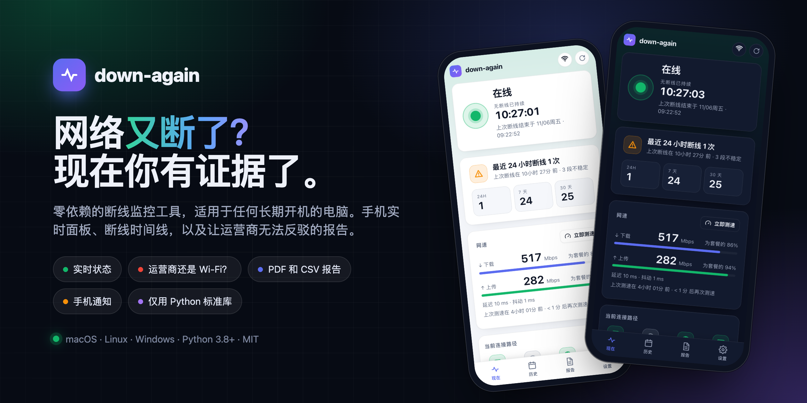
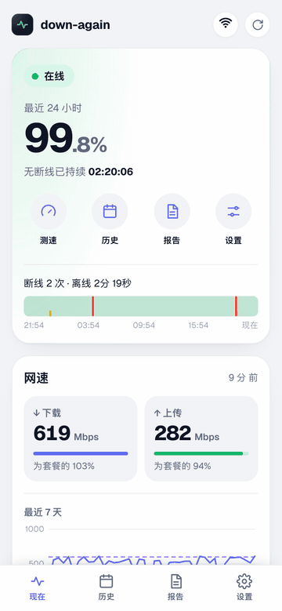
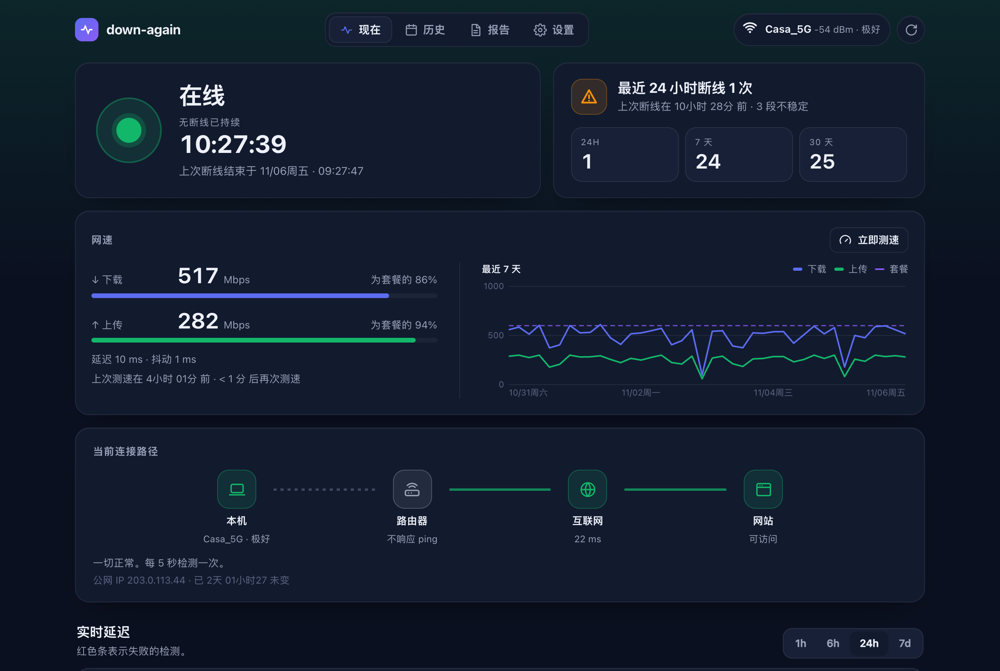
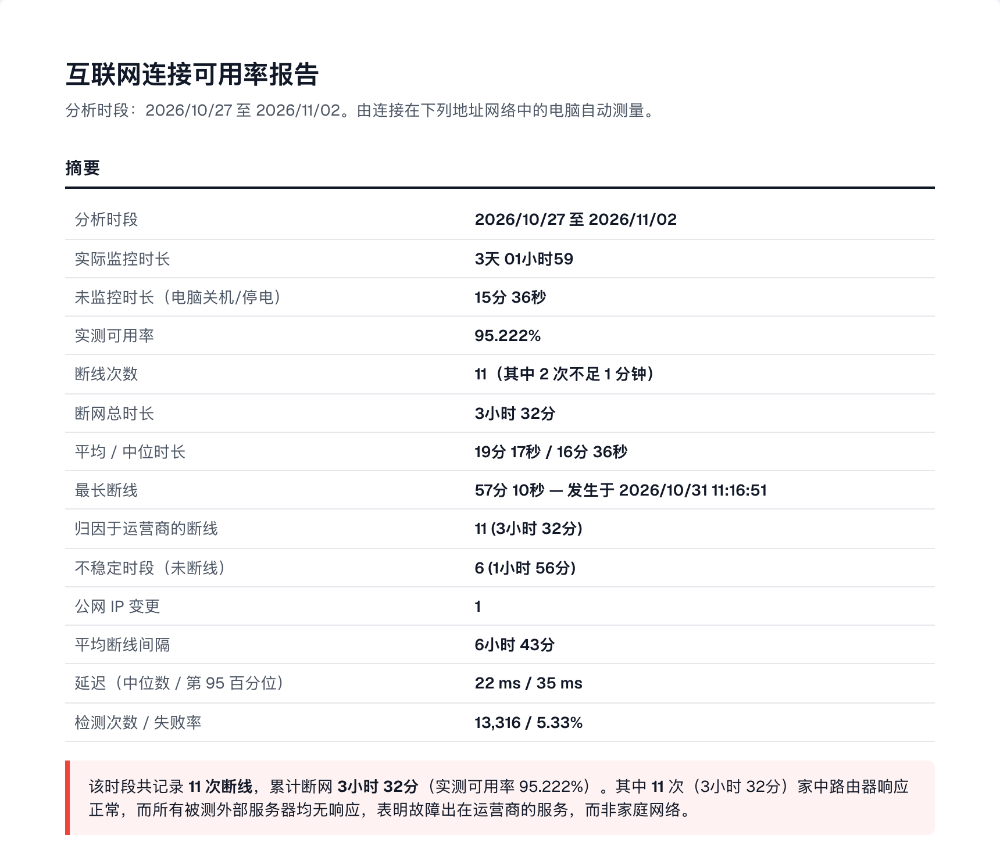

<p align="center">
  
</p>

<p align="center">
  
  
  
  
  
</p>

<p align="center">
  🇺🇸 <a href="README.md">English</a> · 🇧🇷 <a href="README_pt-BR.md">Português</a> · 🇨🇳 <b>中文</b>
</p>

**down-again** 可以在任何长期开机的电脑上监控家庭网络，在手机上显示实时面板，并在网络频繁中断时生成可提交给运营商的报告。

## 功能

- 🟢 **实时状态**：在线或断网，附带计时器和可能原因。
- 🔍 **责任归属**：运营商、你的 Wi-Fi 还是 DNS。
- 📊 **历史记录**：每日时间线，以及 24 小时、7 天、30 天的断线次数。
- 🚀 **测速**：每 30 分钟一次，并与你购买的套餐比较。
- 🧾 **运营商报告**：可打印或保存为 PDF，并可导出 CSV 表格。
- 📱 **手机通知**：网络恢复后立即收到消息。
- 📲 **像应用一样使用**：添加到手机主屏幕，或扫描面板上的二维码。
- 🌐 **3 种语言**：English、Português 和中文。
- 🪶 **零依赖**：只需 Python。即使外网中断，面板也能打开。

## 截图

<table>
  <tr>
    <td width="34%" valign="top"></td>
    <td valign="top">
      <br><br>
      
    </td>
  </tr>
</table>

<sub>截图使用的是模拟数据。</sub>

## 快速开始

```bash
git clone https://github.com/Bruno-Furtado/down-again.git
cd down-again
python3 down_again.py check     # 单次诊断
python3 down_again.py           # 启动监控和面板
```

打开 `http://localhost:8000`，或在手机上打开 `http://<电脑名称>.local:8000`。
如需在后台运行并随电脑启动：

```bash
python3 down_again.py install   # 撤销：python3 down_again.py uninstall
```

在 Windows 上，用 `py` 代替 `python3`。

## 支持的平台

| | 状态 | 后台运行方式 |
|---|---|---|
| **macOS 11+** | ✅ 已测试 | LaunchAgent |
| **Linux**（Raspberry Pi、Ubuntu 等） | ⚠️ 实验性，尚未在真机上测试 | systemd |
| **Windows 10/11** | ⚠️ 实验性，尚未在真机上测试 | 任务计划程序 |

在 Linux 或 Windows 上试过？无论是否成功，都欢迎[提交 issue](https://github.com/Bruno-Furtado/down-again/issues/new/choose) 并附上 `check` 的输出。

## 手机通知

1. 安装 **ntfy** 应用（iOS / Android）。
2. 订阅面板上显示的主题。
3. 点击**发送测试**。

## 更多信息

<details>
<summary><b>工作原理</b></summary>

每 5 秒检测三项：**路由器**（ping）、**按 IP 访问互联网**（`1.1.1.1`、`8.8.8.8`、`208.67.222.222`）以及**按域名访问网站**（DNS）。
连续 2 次检测失败才记为一次断线。

| 观察到的情况 | 原因 |
|---|---|
| 路由器有响应，互联网无响应 | 运营商 |
| 路由器无响应 | 本地网络 / Wi-Fi |
| 可按 IP 访问互联网，但网站打不开 | DNS |
| 路由器从不响应 ping | 无法确定 |

电脑关机或睡眠的时间标记为*未监控*，绝不会被算作断线。
</details>

<details>
<summary><b>配置</b>（<code>dados/config.json</code>）</summary>

| 键 | 默认值 | 作用 |
|---|---|---|
| `language` | `auto` | 通知、CSV 和终端使用的语言：`en`、`pt` 或 `zh`。`auto` 跟随系统 |
| `port` | `8000` | 面板端口 |
| `bind` | `0.0.0.0` | 设为 `127.0.0.1` 时面板仅限本机访问 |
| `allowed_hosts` | `[]` | 面板允许的额外主机名（IP、`localhost`、`*.local` 和本机名称始终可用） |
| `interval` | `5` | 检测间隔（秒） |
| `fail_threshold` | `2` | 连续失败多少次计为断线 |
| `ntfy_topic` | 随机 | ntfy 主题。设为 `""` 可关闭通知 |
| `ntfy_server` | `https://ntfy.sh` | 自建的 ntfy 服务器（如有） |
| `notify_min_seconds` | `0` | 仅通知时长不低于该值的断线 |
| `keep_samples_days` | `120` | 原始检测数据保留天数（断线记录永久保存） |
| `speedtest_minutes` | `30` | 测速间隔（分钟）。`0` 表示关闭 |
| `speedtest_seconds` | `5` | 下载和上传各测量的秒数 |
| `plan_down_mbps` / `plan_up_mbps` | `0` | 你的套餐速度，用于比较每次测速（也可以在面板中设置） |

修改后请重启 down-again。

**测速会消耗流量。**每次测速使用 6 个并发连接到 Cloudflare（`speed.cloudflare.com`），下载和上传各 5 秒。在 500 Mbps 套餐下，每次约 500 MB，每 30 分钟一次约为每月 700 GB。如果套餐有流量上限，请增大 `speedtest_minutes`。测速期间暂停断线检测，结果仅供参考，官方测量请使用监管机构的工具。
</details>

<details>
<summary><b>作为服务器运行</b></summary>

- **用网线连接路由器**，这样断线才能指向运营商，而不是 Wi-Fi 信号弱。
- **macOS：**开启*防止自动进入睡眠*、*断电后自动启动*和自动登录。不要把文件夹放在“桌面”“文稿”或“下载”中。
- **Linux：**运行 `sudo loginctl enable-linger $USER`，以便开机即启动。`.local` 名称需要 `avahi-daemon`。
- **Windows：**将睡眠设为*从不*，网络配置文件设为*专用*。
</details>

<details>
<summary><b>安全</b></summary>

专为**可信的家庭网络**设计。没有登录功能，因此**不要把端口暴露到互联网**。
它可以防御 DNS 重绑定、CSRF 和路径遍历，并发送严格的 Content-Security-Policy。
ntfy 主题相当于密码。
如需报告漏洞，请参阅 [SECURITY.md](SECURITY.md)。
</details>

<details>
<summary><b>API</b></summary>

`GET /api/status`、`/api/glance`、`/api/summary?from=&to=`、`/api/timeseries?hours=`、`/api/outages.csv?from=&to=&lang=` 和 `/api/config`。
`POST /api/test-notify` 需要 `X-Down-Again: 1` 请求头。
</details>

---

<div align="center">
  <sub>在库里蒂巴用 ♥ 制作 🌲 ☔️</sub>
</div>
